<p align="center">
  
</p>

<p align="center">
  <a href="https://www.anypayx.com"></a>
  <a href="https://www.npmjs.com/package/@anypay/walletbot"></a>
  <a href="https://www.npmjs.com/package/@anypay/walletbot"></a>
  <a href="https://hub.docker.com/r/anypay/walletbot"></a>
  <a href="https://github.com/anypay/walletbot/releases"></a>
</p>

<p align="center">
  <a href="https://www.anypayx.com">Website</a> ·
  <a href="https://www.anypayx.com/docs">Docs</a> ·
  <a href="https://api.anypayx.com/api">API</a> ·
  <a href="https://www.anypayx.com/walletbot">WalletBot</a> ·
  <a href="https://github.com/anypay">GitHub</a> ·
  <a href="https://hub.docker.com/r/anypay/walletbot">Docker</a> ·
  <a href="https://www.npmjs.com/package/@anypay/walletbot">npm</a>
</p>

---

## What It Is & Purpose

**Anypay WalletBot** (`@anypay/walletbot`) is a self-custody, headless automated crypto wallet service that runs as a daemon process within your infrastructure. It manages your operation's private keys so your applications can securely send payments across multiple blockchain networks, without exposing sensitive keys to your application code.

WalletBot continuously monitors your Anypay invoice queue via WebSocket connection, automatically signs and broadcasts transactions when payment requests arrive, and confirms settlement on-chain. The bot derives wallet addresses from a single BIP39 mnemonic seed phrase and maintains balances across BTC, BCH, BSV, LTC, DOGE, DASH, and XRP chains.

This is **your money-sending robot friend** — the automated payment engine behind Anypay's self-custody payment processing.

## Why Use It

**WalletBot solves the custody dilemma for automated cryptocurrency payments:** you need to send funds programmatically, but you don't want hot wallet keys sitting in your application servers where they can be extracted or compromised.

- **Who it's for:** Businesses, payment processors, and developers who need to automate outgoing crypto payments while maintaining full custody of their private keys. Ideal for settlement workflows, liquidity management, automated payouts, and payment-on-invoice fulfillment.

- **Where it fits:** WalletBot is the self-custody payment executor in the Anypay ecosystem. While the core Anypay platform (`anypay/anypay`) handles invoice creation, payment requests, and customer-facing checkout flows, WalletBot handles the **sending** side — it listens for your backend's outgoing payment requests and executes them from your self-custodied wallet. Run it in your secure data center, isolated network, or hardware security module environment.

**Key advantages:**

- **True self-custody** — your seed phrase, your keys, your funds. Anypay never touches your private keys.
- **Headless automation** — no manual intervention. WalletBot polls for unpaid invoices and pays them automatically.
- **Multi-chain native** — one bot, six UTXO chains plus XRP. Unified mnemonic wallet with chain-specific derivation paths.
- **Battle-tested** — serving production Anypay merchant payouts and WalletBot-as-a-service customers since 2022.
- **Easy deployment** — npm, Homebrew, Docker, Heroku one-click, or run directly in Node.js/TypeScript.

## How It Works

<p align="center">
  
</p>

WalletBot operates as a long-running daemon that bridges Anypay's invoice system with on-chain settlement:

1. **Anypay Invoice Queue** — Your Anypay account creates payment requests (invoices) via API or dashboard. These invoices enter the "unpaid" queue visible to your authenticated WalletBot instance.

2. **WalletBot Local Signer** — The bot polls Anypay's backend every 5 seconds (or immediately via WebSocket events) for unpaid invoices. When found, it fetches the BIP70-compatible payment options, verifies the request is single-chain and non-XMR (multi-output and Monero are skipped/cancelled), derives the appropriate private key from your mnemonic, and signs the transaction locally. Your seed phrase **never** leaves the WalletBot process.

3. **Broadcast TX Multi-Chain** — WalletBot uses chain-specific broadcast mechanisms (Bitcore for UTXO chains, native RPC for others) to submit the signed transaction to the network. It follows the Payment Protocol flow, posting the signed transaction bytes back to Anypay's `/r/{invoice_uid}` endpoint.

4. **Confirmed Settlement** — Anypay receives the transaction, validates it against the payment request, and monitors the blockchain for confirmation. WalletBot logs the result and updates its internal balance cache. The invoice moves to "paid" status, triggering any configured webhooks.

**WebSocket handlers** (optional, enabled by default):
- `invoice_created` / `invoice_cancelled` / `invoice_paid` — realtime invoice lifecycle events
- `list_balances` / `list_addresses` — inventory queries from Anypay dashboard

**HTTP API** (optional, controlled by `--http-api-enabled`):
- `GET /api/v1/status` — health check
- `GET /api/v1/balances` — current wallet balances
- `GET /api/v1/payments` — recent payment history

**Prometheus metrics** (optional): exposes payment counters, balance gauges, and latency histograms for observability.

## Quickstart / How to Use It

### Prerequisites

- **Node.js 16+** or **Docker**
- A **12-word BIP39 seed phrase** (generate with `walletbot seed-phrase` or any BIP39 tool)
- An **Anypay API auth token** from [anypayx.com/dashboard/apps/wallet-bot](https://www.anypayx.com/dashboard/apps/wallet-bot)

### Installation

**Via npm (global CLI):**

```bash
npm install -g @anypay/walletbot
```

**Via Homebrew (macOS / Linux):**

```bash
brew tap anypay/walletbot
brew install walletbot
```

**Via Docker:**

```bash
docker pull anypay/walletbot
```

### Generate a Seed Phrase

If you don't have a mnemonic yet, generate one:

```bash
walletbot seed-phrase
```

**⚠️ Security:** Write down this seed phrase and store it securely offline. Anyone with access to this mnemonic can spend your funds. Never commit it to version control or expose it in logs.

### Start the Bot

**Command line (npm/Homebrew):**

```bash
walletbot start \
  --seed-phrase="your twelve word seed phrase goes here in quotes" \
  --auth-token=your_anypay_api_token_here
```

**Environment variables (recommended for production):**

```bash
export WALLETBOT_SEED_PHRASE="your twelve word seed phrase goes here"
export WALLETBOT_AUTH_TOKEN=your_anypay_api_token_here

walletbot start
```

**Docker:**

```bash
docker run -e WALLETBOT_SEED_PHRASE="your twelve word mnemonic" \
           -e WALLETBOT_AUTH_TOKEN=your_token \
           anypay/walletbot
```

**Programmatic (Node.js/TypeScript):**

```typescript
import { WalletBot } from '@anypay/walletbot'

const walletBot = new WalletBot({
  seed_phrase: "your twelve word seed phrase goes here",
  auth_token: "your_anypay_api_token_here"
})

walletBot.start()
```

### Configuration Options

```bash
walletbot start [options]

Options:
  -s, --seed-phrase <seed_phrase>                12-word BIP39 seed phrase (required)
  -t, --auth-token <auth_token>                  Anypay API auth token (required)
  -a, --api-base <api_base>                      Anypay API base URL (default: https://anypayx.com)
  -w, --websocket-url <websocket_url>            WebSocket URL (default: wss://wss.anypayx.com)
  -e, --websocket-enabled <websocket_enabled>    Enable WebSocket connection (default: true)
  -h, --http-api-enabled <http_api_enabled>      Enable HTTP API server (default: true)
  -p, --prometheus-enabled <prometheus_enabled>  Enable Prometheus metrics
  -V, --version                                  Output version number
```

**Environment variables:**

- `WALLETBOT_SEED_PHRASE` — your mnemonic (overridden by `--seed-phrase`)
- `WALLETBOT_AUTH_TOKEN` — your API token (overridden by `--auth-token`)
- `WALLETBOT_API_BASE` — API base URL (default `https://anypayx.com`)
- `WALLETBOT_WEBSOCKET_URL` — WebSocket URL (default `wss://wss.anypayx.com`)
- `WALLETBOT_WEBSOCKET_ENABLED` — `true` or `false` (default `true`)
- `HTTP_API_ENABLED` — `true` or `false` (default `true`)

### Additional Commands

**Check balances:**

```bash
walletbot list-balances
```

**Create a payment request (testing):**

```bash
walletbot new-payment \
  --address=12syqu1XwFzGVqTTK5U6EkJaqq2FPeLmRH \
  --currency=BTC \
  --quote=USD \
  --value=1.99
```

**Cancel an invoice:**

```bash
walletbot cancel-payment --uid=F28WujS5X
```

### Deployment

WalletBot is designed to run as a long-lived daemon process. Use a process manager:

- **systemd** (Linux) — create a service unit
- **Docker Compose** / **Kubernetes** — persistent container
- **Heroku** — one-click deploy: [](https://heroku.com/deploy?template=https://github.com/anypay/walletbot)

**Important:** Ensure your seed phrase is injected via secure environment variable mechanism (Kubernetes Secrets, Docker Secrets, Heroku Config Vars). Never hardcode it in Dockerfiles or public repos.

## Next Moves for Growth

WalletBot is a mature production service with active users. Here are high-leverage next steps grounded in the current codebase:

1. **Add Stablecoin Support (ERC-20/SPL)** — The brand spec emphasizes stablecoins (USDC, USDT, RLUSD, NUSD), but WalletBot currently supports only UTXO chains plus XRP. Adding Ethereum/Polygon ERC-20 and Solana SPL token support would align with Anypay's core value proposition. The `simple-wallet` submodule already has extensible asset drivers; Ethereum and Solana wallet implementations could follow the existing pattern.

2. **Publish Comprehensive Test Coverage** — The repo has a test script (`npm run test`) and nyc coverage tooling configured, but many modules (especially chain-specific RPC clients in `src/simple-wallet/src/assets/`) lack visible test files in the repo. Adding integration tests for each supported chain (mocked RPC or testnet) would catch regressions and make contributions safer.

3. **Add a License File** — The `package.json` has an empty `"license": ""` field, and there is no `LICENSE` file in the repository. Clarifying the license (MIT, Apache-2.0, proprietary, etc.) is essential for adoption and contributor confidence. Without a clear license, forks and downstream use are legally ambiguous.

4. **Enable Continuous Integration** — There's no visible GitHub Actions workflow or CircleCI badge in the README. The repo references `.circleci/config.yml` in the `simple-wallet` submodule, but CI status isn't surfaced. Adding automated PR checks (lint, build, test) and publishing coverage reports to Codecov would improve code quality and trust.

5. **Document the HTTP API with OpenAPI** — The bot exposes `GET /api/v1/status`, `/api/v1/balances`, and `/api/v1/payments` endpoints when `http_api_enabled` is true, but there's no OpenAPI spec or inline docs. Generating a Swagger spec (the repo already uses `hapi-swagger` as a dependency) would make the API self-documenting and unlock client SDK generation.

6. **Harden XMR and Multi-Output Handling** — The bot currently **skips** Monero invoices and multi-chain payment options, logging them as cancelled. If Anypay's roadmap includes XMR support or complex multi-output templates, WalletBot's payment logic (in `wallet_bot.ts`) needs to evolve from "skip if `options.paymentOptions.length > 1`" to actual multi-output transaction construction.

## Anypay Ecosystem & License

**Anypay WalletBot** is part of [Anypay](https://www.anypayx.com) — Bitcoin & Stablecoin payments for business. Merchants and developers use Anypay to accept BTC, ETH, and stablecoins such as USDC, USDT, RLUSD, and NUSD through invoices, APIs, SDKs, webhooks, WooCommerce, and mobile POS.

| Project | Role |
| --- | --- |
| [anypay](https://github.com/anypay/anypay) | Invoice & payments platform / API (`@anypay/server`) |
| [anypay-sdk](https://github.com/anypay/anypay-sdk) | TypeScript SDK for browser & Node.js (`@anypay/client`) |
| [web3-checkout-vite](https://github.com/anypay/web3-checkout-vite) | Current checkout UI (`checkout.anypayx.com`) |
| **[walletbot](https://github.com/anypay/walletbot)** | **Self-custody headless wallet (`@anypay/walletbot`)** ← _you are here_ |
| [anypayx.com](https://github.com/anypay/anypayx.com) | Marketing site, merchant dashboard, and developer docs |
| [merchant-app](https://github.com/anypay/merchant-app) | iOS & Android point-of-sale |
| [anypay-woocommerce](https://github.com/anypay/anypay-woocommerce) | Official WooCommerce plugin |

**Related infrastructure:**

- [anypay-simple-wallet](https://github.com/anypay/anypay-simple-wallet) — The low-level wallet library (`anypay-simple-wallet` npm package) embedded in this repo under `src/simple-wallet/`
- [homebrew-walletbot](https://github.com/anypay/homebrew-walletbot) — Homebrew tap for `brew install walletbot`

**License:** No license file is present in this repository. The `package.json` has an empty license field (`"license": ""`). Users should contact [Anypay](https://www.anypayx.com) for clarification on usage rights and distribution terms before forking or deploying in production.

---

<p align="center">
  <a href="https://www.anypayx.com"></a><br/>
  <sub>Bitcoin & Stablecoin Payments For Business · <a href="https://www.anypayx.com">anypayx.com</a> · <a href="https://x.com/xanypay">@xanypay</a></sub>
</p>
